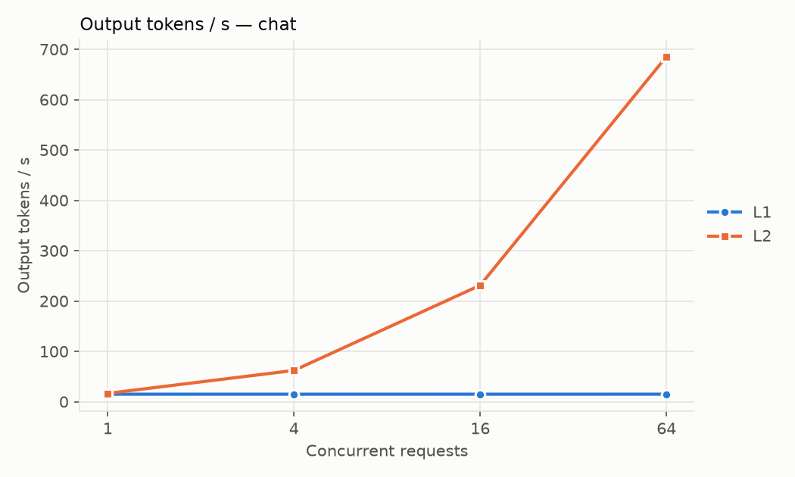
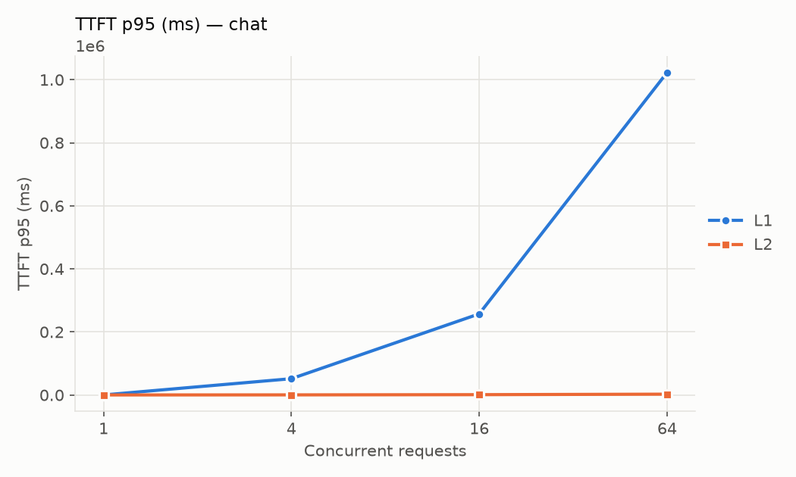
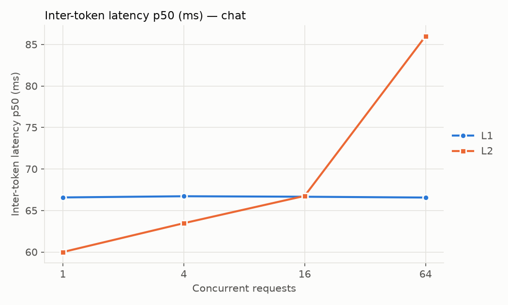
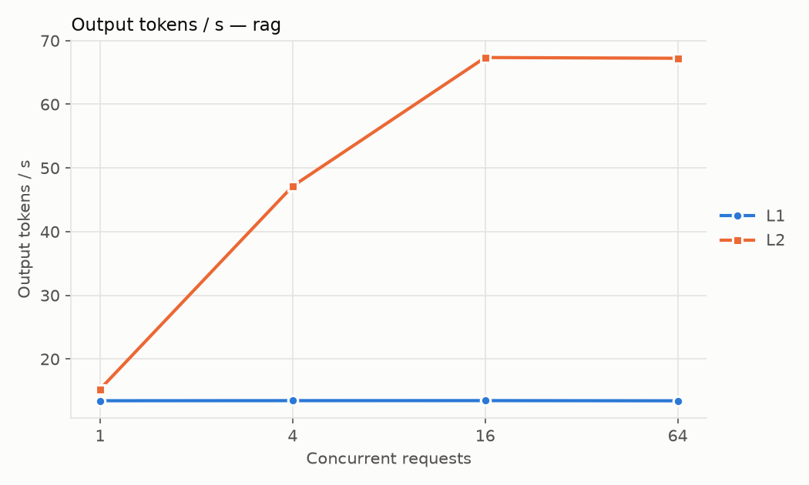
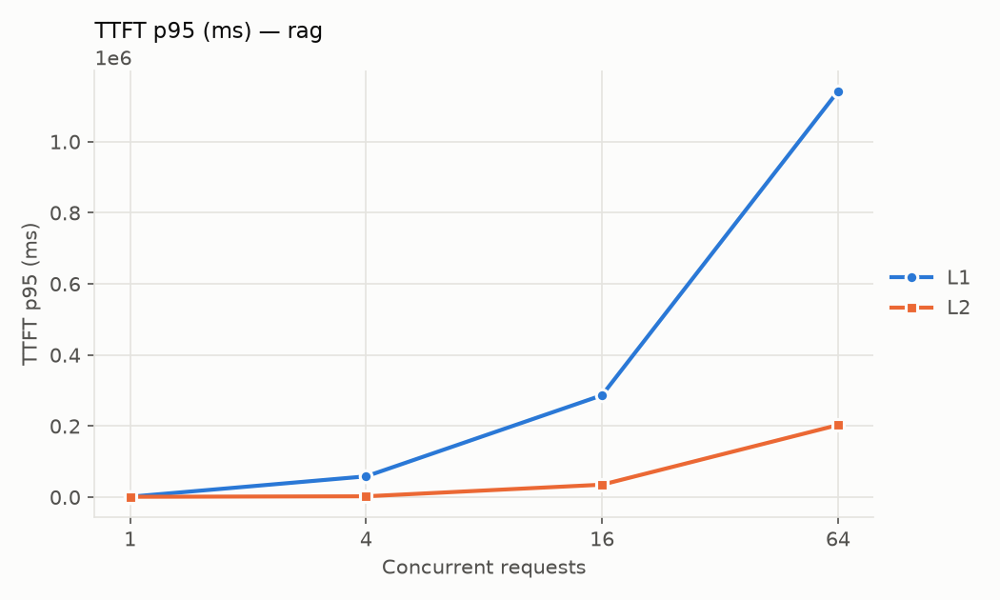
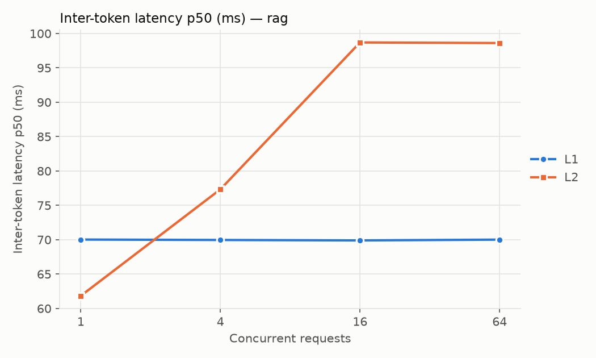

# Qwen3-8B: From Raw Weights to an Optimized vLLM Server

A reproducible, layer-by-layer ablation of LLM inference optimizations on a single
NVIDIA L4. Each level adds one optimization on top of the previous one, and every level
runs the same workload, so each change can be measured on its own, for both speed and quality.

> **Status (2026-10-15):** harness complete and run on Modal. L1 (HF baseline) and L2 (vLLM
> defaults) are finished and reported below. L3–L7 are queued; a first pass of L3 was
> discarded because of the compile-cache effect described under [Lessons](#lessons).
> Every number in this README comes from a saved file in [`results/`](results/) and is
> regenerated by `make plots`. Nothing is estimated.

## Overview

- **Model:** `Qwen/Qwen3-8B` (AWQ variant from L4 onward; `Qwen/Qwen3-0.6B` as the L7 draft model)
- **Serving:** Hugging Face `transformers` baseline (L1) → vLLM OpenAI-compatible server (L2–L7)
- **Harness:** async load generator with fixed seeds, a concurrency sweep, two workloads,
  and a quality check on every run

## Hardware & Versions

| Item | Value |
|---|---|
| GPU | 1× NVIDIA L4 (24 GB) on [Modal](https://modal.com) (`gpu="L4"`) |
| Driver / CUDA | 610.57.04 / CUDA 13.0 for the L1–L2 runs (Modal's hosts change; each run records its own, see the provenance table) |
| vLLM / torch / transformers | 0.31.0 / 2.13.0 / 5.17.0, pinned in [`cloud/modal_app.py`](cloud/modal_app.py) and recorded per run |

## Optimization Levels

| Level | Adds | One-line explanation |
|---|---|---|
| L1 | HF `transformers` baseline | `generate()` one request at a time. No batching; the reference point. |
| L2 | vLLM defaults | PagedAttention stores the KV cache in pages so many sequences share memory. Continuous batching adds and removes requests every step. |
| L3 | FlashAttention backend | Pins the attention kernel to FlashAttention and checks in the logs that it's actually in use. |
| L4 | AWQ 4-bit | Activation-aware 4-bit weights cut memory traffic and leave more room for KV cache. |
| L5 | Scheduler tuning | Tuned `max_num_seqs`, `max_num_batched_tokens`, and chunked prefill to balance TTFT and throughput. |
| L6 | Prefix caching | Reuses KV blocks for a shared system prompt so prefill only covers new tokens. |
| L7 | Speculative decoding | Qwen3-0.6B drafts tokens and the 8B model verifies them in one pass. |

Exact settings for each level are in [`configs/`](configs/).

## Benchmark Method

- **Workloads** are fixed files built once from public datasets with seed 0
  ([sources](bench/workloads/SOURCES.md)):
  - `chat`: 256 UltraChat prompts
  - `rag`: 64 SQuAD v2 questions with ~3–3.6k tokens of passages
  - `shared_prefix`: 128 questions behind one ~2k-token system prompt (used from L5 on)
- **Same output length at every level:** temperature 0, `max_tokens=256`, and the model
  is not allowed to stop early (`ignore_eos`). Qwen3 "thinking" mode is off.
- **Closed-loop concurrency sweep:** 1, 4, 16, 64 requests in flight. L1 serves one
  request at a time, so its higher-concurrency cells measure queueing.
- **Metrics per cell:**
  - TTFT p50/p95: send → first token, including queueing
  - inter-token latency p50/p95: per-request `(t_last − t_first) / (tokens − 1)`
  - output tokens/s and requests/s over the cell's wall-clock time
  - peak GPU memory (`nvidia-smi`)
  - vLLM's KV-cache usage and counter deltas (preemptions, prefix-cache hits,
    spec-decode acceptance)
- **Warm start:** every vLLM server is started twice and only the second start is measured.
  A cold torch.compile / kernel-JIT cache inflates vLLM's startup memory profiling and
  shrinks the KV cache, which made otherwise identical runs differ at high concurrency.
  The result file keeps the KV-cache lines from both starts.
- **No cache carry-over:** the prefix cache is reset before every cell, so a cell can't
  benefit from the previous one.
- **Quality on every level:**
  - GSM8K accuracy (fixed 100 questions)
  - exact greedy-output agreement with the bf16 vLLM reference (L2) on 50 prompts
- **Provenance:** every run writes `results/<level>/<timestamp>.json` with GPU, driver,
  CUDA, vLLM/torch/transformers versions, git SHA, the full resolved config, the server
  command line, matching server log lines (e.g. which attention backend was actually
  selected), and sha256 hashes of the workload files.
- **Crash-safe:** results are saved after every cell. Re-running the same command resumes.

## Results

<!-- RESULTS:START -->
#### Workload: `chat`

| Level | Conc. | Out tok/s | Req/s | TTFT p50 / p95 (ms) | ITL p50 / p95 (ms) | Peak GPU mem (MiB) | OK |
|---|---|---|---|---|---|---|---|
| L1 | 1 | 15.0 | 0.06 | 92 / 188 | 66.6 / 66.9 | 16101 | 64/64 |
| L1 | 4 | 14.9 | 0.06 | 51,457 / 51,753 | 66.7 / 67.2 | 16101 | 64/64 |
| L1 | 16 | 15.0 | 0.06 | 256,505 / 257,322 | 66.7 / 67.0 | 16103 | 64/64 |
| L1 | 64 | 15.0 | 0.06 | 538,199 / 1,022,814 | 66.6 / 66.9 | 16103 | 64/64 |
| L2 | 1 | 16.6 | 0.06 | 81 / 176 | 60.0 / 60.2 | 20503 | 256/256 |
| L2 | 4 | 62.1 | 0.24 | 265 / 413 | 63.5 / 64.3 | 20573 | 256/256 |
| L2 | 16 | 231.3 | 0.90 | 669 / 1,067 | 66.8 / 68.5 | 20717 | 256/256 |
| L2 | 64 | 685.5 | 2.68 | 1,516 / 2,649 | 86.0 / 91.1 | 20717 | 256/256 |

#### Workload: `rag`

| Level | Conc. | Out tok/s | Req/s | TTFT p50 / p95 (ms) | ITL p50 / p95 (ms) | Peak GPU mem (MiB) | OK |
|---|---|---|---|---|---|---|---|
| L1 | 1 | 13.4 | 0.05 | 1,189 / 1,234 | 70.0 / 70.5 | 17381 | 64/64 |
| L1 | 4 | 13.5 | 0.05 | 58,170 / 58,502 | 70.0 / 70.5 | 17381 | 64/64 |
| L1 | 16 | 13.5 | 0.05 | 286,042 / 286,668 | 69.9 / 70.6 | 17381 | 64/64 |
| L1 | 64 | 13.4 | 0.05 | 601,743 / 1,141,914 | 70.0 / 70.7 | 17381 | 64/64 |
| L2 | 1 | 15.3 | 0.06 | 997 / 1,047 | 61.8 / 61.9 | 20717 | 64/64 |
| L2 | 4 | 47.1 | 0.18 | 1,982 / 2,408 | 77.3 / 80.9 | 20717 | 64/64 |
| L2 | 16 | 67.3 | 0.26 | 31,124 / 35,104 | 98.7 / 121.1 | 20717 | 64/64 |
| L2 | 64 | 67.2 | 0.26 | 110,081 / 202,950 | 98.6 / 122.9 | 20717 | 64/64 |

#### Quality

| Level | GSM8K acc. | Greedy exact-match vs ref | Mean shared-prefix vs ref |
|---|---|---|---|
| L1 | 0.970 (n=100) | 0.200 (vs L2) | 0.464 |
| L2 | 0.960 (n=100) | – | – |

#### Provenance

| Level | Name | GPU | Driver | CUDA | vLLM | Started (UTC) | Result file |
|---|---|---|---|---|---|---|---|
| L1 | hf-baseline | NVIDIA L4 | 610.57.04 | 13.0 | 0.31.0 | 2026-10-13T15:37:11 | `results/L1/20261013T153711Z.json` |
| L2 | vllm-defaults | NVIDIA L4 | 610.57.04 | 13.0 | 0.31.0 | 2026-10-13T18:49:49 | `results/L2/20261013T184949Z.json` |







<!-- RESULTS:END -->

## Reproduce

The GPU side runs on [Modal](https://modal.com): one function call per level, with the
vLLM server and the load generator in the same container so latencies never include the
internet. Weights and results live on Modal Volumes.

```bash
cp .env.example .env        # optional: HF_TOKEN (Qwen3 is public; a token avoids rate limits)
make setup                  # dev + bench + Modal client deps (CPU)
modal setup                 # once: authenticate the Modal CLI
make modal-smoke LEVEL=L2   # tiny end-to-end check on an L4 (results/_smoke/, not committed)
make modal-bench LEVEL=L3   # one level in the background: server + every cell + quality
make modal-sweep LEVEL=L5   # a level's parameter sweep (L3 backends, L5 scheduler, L7 k)
make modal-bench-all        # all levels, sequentially
make modal-logs             # follow a background run
make pull-results           # copy finished result JSONs into results/
make plots                  # summary table + plots + README results, from results/ only
make down                   # stop any running server / Modal app
make workloads              # (optional) rebuild the workload files from source datasets
```

The same harness runs on any machine with an NVIDIA GPU: `make setup-gpu`, then
`make smoke|bench|sweep|bench-all LEVEL=…` (no Modal involved).

## Lessons

Written as the runs come in; each lesson names the result files it is drawn from.

1. **A cold `torch.compile` cache silently shrinks vLLM's KV cache by about a gigabyte.**
   vLLM sizes the KV cache from a startup memory profile. With a warm compile cache the L2
   run profiled 0.62 GiB of peak activation and got 27,184 KV tokens; the first-pass L3
   runs, identical except for a cold cache, profiled 1.61 GiB and got 19,936 tokens
   (`results/L2/20261013T184949Z.json` vs
   `results/L3/20261013T153813Z__attention_backend-FLASH_ATTN.json`). At 64 concurrent chat
   requests that was 685.5 vs 558.7 output tok/s and 3 vs 79 preemptions, a "regression"
   with nothing to do with the attention backend. The harness now starts every vLLM server
   twice and measures the second start; the first-pass L3 files are kept for provenance but
   excluded from the tables.
2. **Without batching, concurrency only buys queueing.** L1 serves one request at a time:
   15.0 output tok/s whether 1 or 64 requests are in flight, while median time to first
   token grows from 92 ms to 538 s (`results/L1/20261013T153711Z.json`). L2's continuous
   batching turns the same 64 requests into 685.5 tok/s at 1.5 s median TTFT.
3. **bf16 on a 24 GB card is KV-cache-bound on long prompts.** On the ~3.3k-token rag
   workload L2 tops out at 67 tok/s from 16 in flight upward, with the server reporting at
   most 8 running requests and the rest waiting (`results/L2/20261013T184949Z.json`).
   That is the headroom the AWQ level is meant to recover.

## License

MIT. See [LICENSE](LICENSE).
